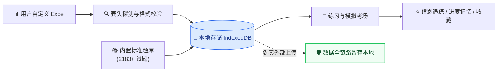

# 🛡️ Quiz Forge

[](https://github.com/BUG423/app-quiz-forge/releases)
[](https://github.com/BUG423/app-quiz-forge/actions)
[](https://react.dev/)
[](https://www.typescriptlang.org/)
[](https://web.dev/progressive-web-apps/)
[](https://capacitorjs.com/)
[](https://creativecommons.org/licenses/by-nc-nd/4.0/)

> **Quiz Forge（安知刷题）** 是一款内置专业题库、隐私离线优先、且支持自定义 Excel 导入的跨平台智能刷题应用。基于现代 Web 技术与移动容器打造，提供无缝的 Web/PWA 与原生 Android 客户端体验。

---

## 📦 下载与安装

前往 **[GitHub Releases 最新发布页](https://github.com/BUG423/app-quiz-forge/releases/latest)** 获取安装包：

| 交付形式 | 文件说明 | 适用平台 |
|---|---|---|
| 📱 **Android 原生客户端** | `quiz-forge-android-*.apk`（独立签名安装包） | Android 7.0+ 手机 / 平板 |
| 🌐 **PWA / Web 部署包** | `quiz-forge-pwa-*.zip`（离线静态 Web 资源） | 现代浏览器 / 静态 Web 托管 |
| 📊 **Excel 导入模板** | `quiz-forge-import-template.xlsx`（17 列标准化题库模板） | 全平台导入制作 |
| 🔒 **文件校验** | `SHA256SUMS.txt`（发布二进制完整性校验值） | 安全校验 |

---

## ✨ 核心特性

- **🛡️ 隐私零上报与完全离线**：默认内置 **7 个专业题库、2183 道试题**，安装即刷；刷题进度、答题卡、错题本与自导题库全量存储于本地 IndexedDB，绝不向远程服务器同步隐私数据。
- **📊 智能 Excel 题库解析引擎**：流式解析 `.xlsx` 格式，支持前 30 行表头自动探测与别名自适应映射（如“试题难易/难度”、“标准答案/答案”等），自动清洗冗余选项前缀并剔除空白样式噪声。
- **🎯 科学练习与模拟实战**：
  - **丰富题型覆盖**：支持单选、多选、判断、填空与案例分析题。
  - **智能刷题模式**：支持按题库、知识分类、难度、保命题专项筛选，支持顺序刷题与随机洗牌。
  - **全真考场模拟**：根据规则一键组卷，倒计时统一交卷与自动化判题复盘。
- **⭐ 错题追踪与精准备考**：自动归纳错题，支持针对性消灭错题、单题移出与重点题目一键收藏。
- **📱 跨端运行与统一体验**：同时提供响应式 Web 端、可离线安装的现代 PWA，以及基于 Capacitor 封装的原生 Android 客户端。

---

## 🧭 数据架构



---

## 🚀 快速上手与运行

### 1. 开发调试

```bash
# 克隆仓库
git clone git@github.com:BUG423/app-quiz-forge.git
cd app-quiz-forge

# 安装依赖并启动本地开发服务
npm install
npm run dev
```

启动后在浏览器打开控制台提示的本地访问地址即可进入刷题界面。

### 2. 生产构建与预览

```bash
# 运行单元与逻辑测试
npm run test

# 构建生产产物
npm run build

# 本地预览构建产物
npm run preview
```

### 3. Android 客户端打包

```bash
# 同步前端产物至 Capacitor Android 工程
npm run android:sync

# 编译 Android 安装包
cd android
./gradlew assembleRelease
```

---

## 📊 Excel 题库导入指引

系统推荐采用 17 列标准模板，也可在应用设置中一键下载或通过命令行生成：

```bash
npm run template -- ./quiz-forge-import-template.xlsx
```

| 序号 | 字段 | 必填 | 规范说明 |
|:---:|---|:---:|---|
| 1 | 题型 | ✅ | 单选题 / 多选题 / 判断题 / 填空题 / 案例题 |
| 2 | 难易度 | ✅ | 易 / 中 / 难（支持模板下拉选择） |
| 3 | 知识类别 | ✅ | 自定义考点与知识点分类 |
| 4 | 题干 | ✅ | 试题正文内容 |
| 5–13 | A–I 选项 | 按题型 | 选项内容（系统自动清除 `A.`、`B、` 等前缀） |
| 14 | 答案 | ✅ | 单选填 `A`，多选填 `AB`，判断填 `正确/错误` |
| 15 | 出自规范 | — | 规范依据 / 出处条款说明 |
| 16 | 是否保命题 | — | `是/否` |
| 17 | 备注 | — | 试题解析或填空答案（多个空以逗号分隔） |

---

## 📄 知识产权与开源协议

本项目遵循 **[Creative Commons Attribution-NonCommercial-NoDerivatives 4.0 International (CC BY-NC-ND 4.0)](https://creativecommons.org/licenses/by-nc-nd/4.0/)** 严格非商业开源许可：

- ❌ **严禁商用**：任何个人或组织不得将本项目源码、编译产物或衍生版本用于任何商业盈利目的。
- ❌ **禁止演绎与分发修改版**：未经授权不得散布基于本项目修改后的二次分发版本。
- 🔒 **权利保留**：作者保留对本项目代码与架构的所有版权与法律追责权利。
